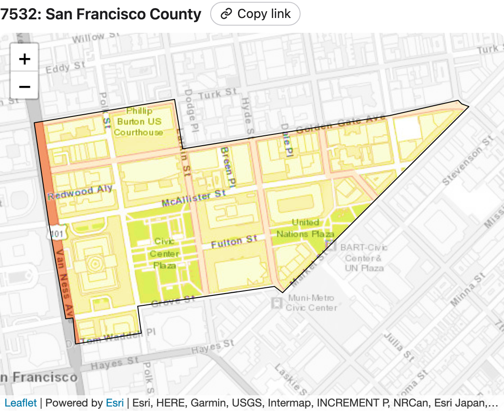
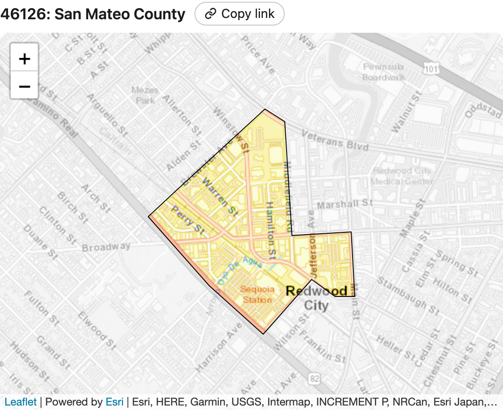
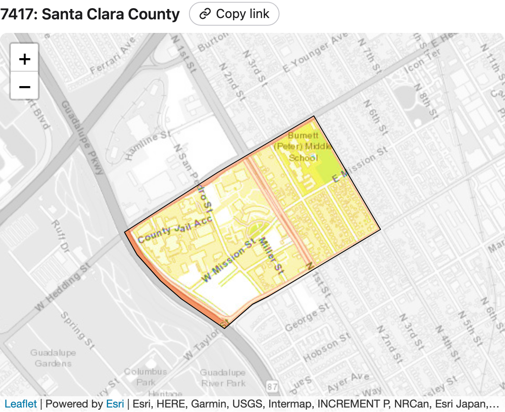

# Precinct from street ranges

Street ranges built from public data turn a street address into a precinct. The lookup runs in the
browser from static files, so it needs no API call and the address never leaves the device. A
[sample app](https://precinct.netpress.com/) on GitHub Pages covers all 58 California counties and
shows each precinct on a map.

  
  
  

A range is a run of house numbers on one side of a street, all in one precinct:

    {"W BAYSHORE RD": [[1200, 1498, "4140011"], [1201, 1499, "4140011"]]}

## Output

Everything in `counties/` is published under `https://precinct.netpress.com/counties/`.

| File | What it holds |
| --- | --- |
| `index.json` | Each county's name and zipcodes |
| `<county>/streets/<zip>.json` | The ranges for one zipcode |
| `<county>/shapes/<zip>.json` | The outline of each precinct in that zipcode, as GeoJSON with the precinct as each feature's `id` |
| `<county>/shapes/index.json` | A zipcode for each precinct |

The county is California's county number, which also starts each precinct number: 01 is
Alameda, 07 is Contra Costa, 38 is San Francisco, 41 is San Mateo, 43 is Santa Clara. A zipcode that crosses a county line has a
file in each county. Which races a precinct votes in is left to whatever app uses these files.

## Sources

| Source | What it gives |
| --- | --- |
| [Census TIGER 2026](https://www.census.gov/geographies/mapping-files/time-series/geo/tiger-line-file.html) `ADDRFEAT` | Address range on each side of each street segment, and the face it borders |
| Census TIGER 2026 `FACES` | Each face's Census block and ZCTA |
| [Statewide Database (SWDB)](https://statewidedatabase.org/) `c<county>_p26_rg_blk_map.csv` | Registered voter counts by precinct and Census block, June 2026 primary |
| County precinct shapes | Each precinct's shape |
| SWDB precinct shapes, where the county publishes none | Each precinct's shape, from the last election |
| County address points | Real addresses and where they are |
| County parcels with site addresses, where there are no address points | Each parcel's middle stands in for an address point |
| County street extract, where there is one | Each address's precinct, from the county's elections office |

This is not an official source, and no county has reviewed it. The goal
is for each county to publish this itself, as San Francisco does; [Public precinct
data](docs/PUBLIC_PRECINCT_DATA.md) explains what that takes. The MIT license covers the code; the data in `counties/` is [CC BY 4.0](https://creativecommons.org/licenses/by/4.0/), crediting each county's sources ([Sources](docs/SOURCES.md)).
Each source's data stays under that source's own terms, and Santa Clara County provides its GIS
data as is, with official records to be consulted for verification.

## How they're built

- Where a county publishes its street extract, the ranges come straight from it.
- Otherwise real addresses come first: each address point placed on the county's map, with
  runs of house numbers in one precinct on one side of a street becoming ranges.
- The rest of a street comes from Census, around those ranges. A side whose whole
  length falls in one precinct on the county's map gets that precinct.
- Otherwise it gets its block's precinct: the one with at least 90% of the block's voters.
- A side with neither gets no range.
- Neighboring ranges on one side with the same precinct merge, when their numbers
  are within 100 of each other.

## Where the files come from

This repo publishes the ranges and the page that reads them; the build that makes `counties/` isn't
part of it. [Sources](docs/SOURCES.md) lists what each county gives us and how the ranges
were checked. The county's precinct map settles any disagreement.

Santa Clara's precinct shapes come free by request from the Registrar of Voters, using Option 2 on
[its form](https://vote.santaclaracounty.gov/precinct-data-and-gis-maps). San Francisco publishes
[its datasets](https://sfelections.org/tools/election_data/datasets.php), including its address table as
the Street Data Extract and a precinct shapefile; only the street, house number, zipcode and precinct
are used.

## Publishing

The sample app is `public/`, with `public/main.js` built from `src/`. Pushing changes to `public/`
or `counties/` deploys it to GitHub Pages, using `.github/workflows/pages.yml`.
