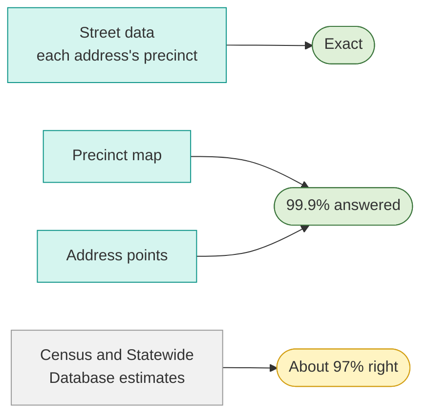

# Public precinct data

We're building a free lookup for every California county: type an address, see its precinct.
It's built only from public data, and it needs two things from each county.

## What we need

1. **A precinct map:** the current precinct boundaries, with each precinct's number. The same
   file a county sends the Statewide Database for each statewide election is ideal.
2. **Address points:** every address with its house number, street and zipcode, and its
   location. No voter information.

Any format works: a shapefile, GeoJSON, a CSV with latitude and longitude, or a link to a
public map layer. With each address point placed on the precinct map, the lookup answers
99.9% of addresses.

About half of California's counties already publish both on their GIS sites, and the lookup
reads them directly.

## Even better: street data

A **street data file** lists every address with its precinct: house number, street, zipcode
and precinct. It's the county's own answer, so the lookup is exact. Election offices often
have one already, called a street data extract or a street index. A GIS team can
publish the same thing as a precinct column on its address points.

| County | Street data |
| --- | --- |
| San Francisco | The Street Data Extract, on the Department of Elections' [election datasets page](https://sfelections.org/tools/election_data/datasets.php) |
| Monterey | The same files, on the Elections Department's [voter data and GIS page](https://www.countyofmonterey.gov/government/departments-a-h/elections/candidates/voter-data-and-gis-shape-files/) |
| San Benito | An [address layer](https://services2.arcgis.com/NjMFCzThTMQy3AJa/arcgis/rest/services/ArcOnline_Addresses/FeatureServer/0) with each address's precinct |
| Inyo | [Attributed addresses](https://gis.inyo.gov/server/rest/services/AttributedAddresses/FeatureServer/0) with each address's precinct |
| El Dorado | A street data table, sent on request |

## Without them

Where a county has neither, the lookup estimates from Census street ranges and the Statewide
Database. Census ranges are possible house numbers, not real addresses, and the Statewide
Database publishes each election's precincts months afterward, after counties have already
changed lines for the next one. Tested on San Francisco, where the street data gives the
right answer, the estimate missed about 6,500 of 223,562 homes. The misses are corner lots,
new homes and houses along a precinct line: the addresses the county already knows.

